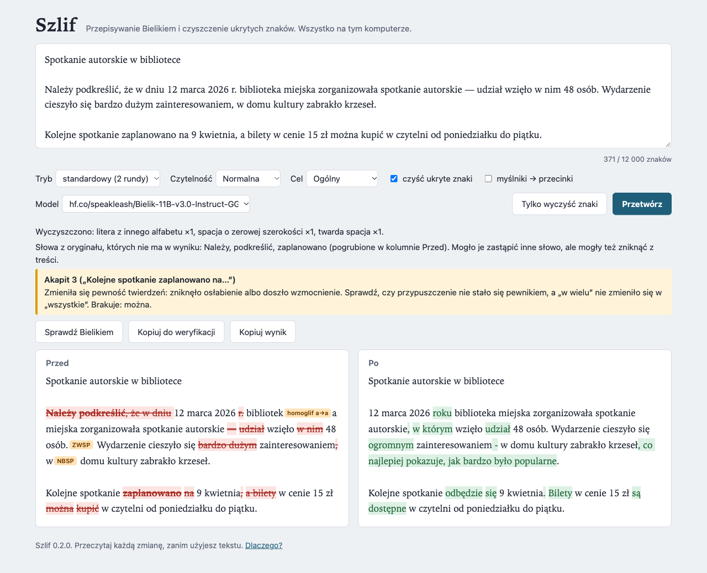
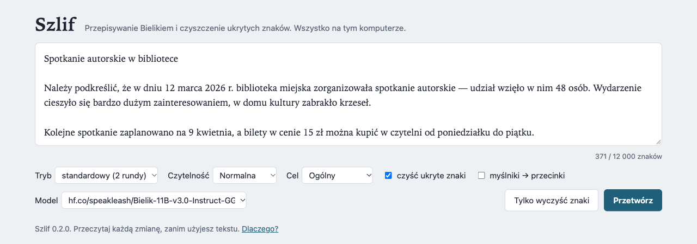

# Szlif

> **In English.** Szlif is a small local tool for Polish text. It rewrites a text with the Bielik language model, run by Ollama on your own computer, and it cleans out hidden characters: zero-width spaces, BOM, unusual spaces and look-alike letters from other alphabets. A local web page shows the text before and after, side by side, with every change marked. It warns when a number, unit or date changed. It does not promise to fool AI detectors or to remove statistical watermarks. It needs only Python 3.9+ (standard library) and runs on macOS and Windows.

Szlif przepisuje polski tekst modelem Bielik i czyści go z ukrytych znaków. Model działa na Twoim komputerze. Na stronie w przeglądarce widzisz tekst **przed** i **po**, obok siebie, z zaznaczoną każdą zmianą.



## Co robi

- **Przepisywanie Bielikiem.** Akapit po akapicie, w jednej, dwóch albo trzech rundach: rytm zdań, słownictwo, przejścia między zdaniami. Akapit kończy się pustym wierszem albo zwykłym Enterem (tak wkleja się tekst z Worda czy Google Docs), a wiersz złamany w środku zdania (np. z PDF) jest łączony z następnym. Nagłówki, pozycje list, cytaty, tabele i akapity krótsze niż 12 słów zostają bez zmian. Model działa lokalnie przez [Ollamę](https://ollama.com).
- **Czyszczenie ukrytych znaków.** Usuwa spacje o zerowej szerokości, znacznik BOM, miękkie dywizy, znaki sterujące kierunkiem tekstu i ukryty tekst ze znaków „tag”. Nietypowe spacje zamienia na zwykłe. Litery z cyrylicy lub greki udające łacińskie zamienia na łacińskie, ale tylko wewnątrz słów, które mają też litery łacińskie. Na życzenie zamienia myślniki na przecinki. Każda zmiana jest widoczna na stronie jako pomarańczowa etykieta. Czyszczenie działa także bez modelu.
- **Strażnik.** Ostrzega, gdy w wyniku brakuje liczby, jednostki, daty albo godziny z oryginału albo gdy pojawiła się nowa. Ostrzega też, gdy akapit wyraźnie się skrócił (poniżej 70% słów) albo urósł (powyżej 140%, a przy krótkim akapicie o więcej niż 6 słów), gdy zmieniła się liczba akapitów i gdy wynik zaczyna mówić o samym tekście („rytm”, „zdania”). To ostatnie znaczy zwykle, że do tekstu przeciekło polecenie dla modelu.

## Czego Szlif nie robi

- Nie obiecuje, że tekst „przejdzie” przez detektory AI.
- Nie usuwa statystycznych znaków wodnych (szczegóły niżej, w części o AI Act).
- Nie gwarantuje sensu. Strażnik sensu nie rozumie, a model, który go sprawdza („Sprawdź Bielikiem”), też się myli. Nazwy, twierdzenia i ton musisz przeczytać sam (zobacz [Jakość](#jakość)).
- Nie wysyła tekstu poza komputer, chyba że sam wskażesz zewnętrzny serwer. Wtedy strona pokazuje czerwony pasek.

## Szybki start: macOS

1. Sprawdź Pythona: `python3 --version` (potrzebna wersja 3.9 lub nowsza). Za pierwszym razem macOS może zaproponować instalację narzędzi Xcode. Zgódź się.
2. Pobierz Szlif:
   ```
   git clone https://github.com/akworob/szlif.git
   cd szlif
   ```
   Bez gita: na stronie repozytorium wybierz **Code → Download ZIP** i rozpakuj.
3. Zainstaluj model:
   ```
   python3 szlif.py instaluj
   ```
   Instalator robi kolejno:
   - instaluje Ollamę przez [Homebrew](https://brew.sh); bez Homebrew poprosi o pobranie Ollamy ze strony [ollama.com/download](https://ollama.com/download);
   - proponuje wyłączenie funkcji chmurowych Ollamy;
   - pobiera Bielika dobranego do pamięci RAM;
   - sprawdza go na krótkim akapicie.

   **Przed każdą zmianą w systemie pyta t/n.**
4. Uruchom stronę:
   ```
   python3 szlif.py
   ```
   Przeglądarka otworzy się sama. Ctrl+C w terminalu zamyka Szlif.

Instalator na komputerze, na którym Ollama i model już są:

```
Szlif: instalator. Python 3.12.7, system Darwin.
Ollama działa pod http://127.0.0.1:11434.
Funkcje chmurowe Ollamy są wyłączone.
Pamięć RAM: 36 GB. Model dla tego komputera: hf.co/speakleash/Bielik-11B-v3.0-Instruct-GGUF:Q6_K (9,2 GB).
Model jest już pobrany.
Próba na krótkim akapicie…
  przed: Uprzejmie informujemy, że spotkanie odbędzie się 9 kwietnia o godz. 18:00 w sali nr 2. Udział w spotkaniu jest bezpłatny. Prosimy o wcześniejsze potwierdzenie obecności.
  po:    Spotkanie odbędzie się 9 kwietnia o godzinie 18:00 w sali nr 2. Udział jest bezpłatny, ale prosimy o wcześniejsze potwierdzenie obecności.
Gotowe. Uruchom: python3 szlif.py
```



## Szybki start: Windows

1. Zainstaluj Pythona w PowerShellu:
   ```
   winget install -e --id Python.Python.3.13
   ```
   Możesz też użyć instalatora z [python.org](https://www.python.org/downloads/windows/). Zaznacz w nim „Add python.exe to PATH”. Potem otwórz nowe okno terminala.
2. Pobierz Szlif przez `git clone https://github.com/akworob/szlif.git`, a potem `cd szlif`. Możesz też pobrać ZIP przez **Code → Download ZIP**.
3. Zainstaluj model:
   ```
   py szlif.py instaluj
   ```
   Instalator zainstaluje Ollamę przez `winget`, a resztę zrobi tak samo jak na macOS. Bez `winget` poprosi o pobranie Ollamy ze strony [ollama.com/download](https://ollama.com/download).
4. Uruchom stronę:
   ```
   py szlif.py
   ```

Strona wygląda na Windows tak samo jak na zrzutach powyżej. **Uczciwie:** na Windows Szlif sprawdzają testy automatyczne (GitHub Actions: testy jednostkowe i próbny start strony). Instalatora nie uruchamiano jeszcze na prawdziwym komputerze z Windows. Jeśli coś nie działa, zgłoś to w zakładce Issues.

## Jak czytać wynik

- **Lewa kolumna to oryginał.**
  - Przekreślone na czerwono: tekst, który zniknął.
  - Pomarańczowe etykiety: wyczyszczone znaki. Najedź na etykietę, żeby zobaczyć nazwę znaku.
  - Żółte podkreślenie: wartość, której nie ma w wyniku.
- **Prawa kolumna to wynik.** Na zielono jest to, co doszło.
- **Nad kolumnami** widać, co wyczyszczono, ostrzeżenia o liczbach (zaznaczone też w tekście) i notatki przy konkretnych akapitach, np. „Akapit 4 (…)”, z powodem ostrzeżenia.
- **Tryby:**
  - prosty (1 runda: rytm zdań);
  - standardowy (2 rundy: plus słownictwo);
  - wzmocniony (3 rundy: plus przejścia).
- **Każdy akapit przechodzi rundy osobno**, a każdą rundę porównujemy z jego oryginałem. Seria zatrzymuje się na pierwszym ostrzeżeniu. Runda 1 z ostrzeżeniem zostaje pokazana, żebyś sam zdecydował. Późniejsza runda z ostrzeżeniem jest odrzucana i zostaje runda przed nią. Seria kończy się też wtedy, gdy runda niczego nie zmienia.
- **Limit to 12 000 znaków.** Dłuższy tekst podziel na części.
- **Akapity krótsze niż 12 słów zostają bez zmian.** Pojedyncze zdanie model lubi „uzupełniać” zmyśloną treścią.

## Weryfikacja i automatyzacja

Strażnik sprawdza liczby i długość zawsze tak samo, ale sensu nie rozumie. Dlatego Szlif może zlecić modelowi porównanie: od razu na stronie albo przez prompt, który wkleisz do drugiego modelu. Model porównuje każdy przepisany akapit z oryginałem i odpowiada w jednym formacie: „Akapit N: BEZ ZMIAN” albo lista: co akapit po przepisaniu **DODAJE**, co **POMIJA** i co **ZMIENIA** (liczby, nazwy, pewność, zakres).

### Na stronie: „Sprawdź Bielikiem”

Po przetworzeniu kliknij **Sprawdź Bielikiem**. Model wybrany na liście **Model** (domyślnie Bielik w Ollamie) porównuje każdy zmieniony akapit z oryginałem. Jego odpowiedź pojawia się pod podsumowaniem, nad kolumnami Przed i Po.

- **Tekst nie wychodzi z komputera**, jeśli model działa lokalnie. Przy zewnętrznym serwerze trafia tam, gdzie przepisywanie.
- **Długi tekst idzie w częściach**, po kilka akapitów, żeby model nie uciął promptu. Strona pokazuje postęp („Sprawdzam część 2 z 3…”), a odpowiedzi z gotowych części widać od razu.
- **Przerwij** kończy czekanie. Odpowiedzi z gotowych części zostają na stronie. Bieżącą część model dokończy w tle, a jej odpowiedź przepada.
- **Przycisk pojawia się tylko wtedy, gdy któryś akapit się zmienił.** Przy modelu innym niż Bielik nazywa się „Sprawdź modelem”.
- **Lepiej sprawdza inny model** niż ten, który przepisywał. Wybierz go na liście **Model** przed kliknięciem. Jeśli masz tylko Bielika, drugą parą oczu może być model w chmurze przez „Kopiuj do weryfikacji”.
- Odpowiedź to lista miejsc do przeczytania, a nie werdykt. Gdy model urwie odpowiedź na limicie długości, strona to napisze.

### Na stronie: „Kopiuj do weryfikacji”

Po przetworzeniu kliknij **Kopiuj do weryfikacji**. W schowku jest prompt z ponumerowanymi parami akapitów PRZED i PO oraz uwagami strażnika. Gdzie go wkleić:

- **Lokalnie, do Bielika.** Tekst nie wychodzi z komputera:
  - macOS: `ollama run hf.co/speakleash/Bielik-11B-v3.0-Instruct-GGUF:Q6_K "$(pbpaste)"`
  - Windows (PowerShell, niesprawdzone; PowerShell 5.1 potrafi zepsuć cudzysłowy w tekście, więc pewniej kliknąć **Sprawdź Bielikiem**): `ollama run hf.co/speakleash/Bielik-11B-v3.0-Instruct-GGUF:Q6_K (Get-Clipboard -Raw)`
- **Długie teksty:** `ollama run` ma zwykle mały kontekst i może uciąć długi prompt, zaczynając od instrukcji. Przy więcej niż kilku akapitach kliknij **Sprawdź Bielikiem**, użyj `szlif.py przepisz --sprawdz` albo modelu z dużym kontekstem.
- **Do Claude, ChatGPT, Gemini albo Groka.** Wtedy tekst trafia do chmury, więc nie rób tego z tekstami poufnymi.

**Uczciwie:** weryfikator też się myli. W naszym teście Bielik wyłapał dopisaną radę, zmianę „może” → „zawsze” i pominięcie, ale wypisywał też zmiany samego stylu. W innej wersji promptu (z tabelą) przeoczył dopisane zdanie. Lepszą drugą parą oczu jest model inny niż ten, który przepisywał. Ostatnie słowo i tak należy do człowieka.

### Z wiersza poleceń: skrypty i agenci

```
python3 szlif.py przepisz tekst.txt --wynik wynik.txt --raport raport.json --weryfikacja prompt.txt --sprawdz
```

- **`--tryb prosty|standardowy|wzmocniony`**: liczba rund, domyślnie standardowy.
- **`--wynik PLIK`**: zapis wyniku do pliku; domyślnie standardowe wyjście. `-` zamiast pliku wejściowego oznacza standardowe wejście, np. `pbpaste | python3 szlif.py przepisz - | pbcopy`.
- **`--raport PLIK`**: raport w JSON. Zawiera:
  - `akapity`, a w każdym: `numer`, `przed`, `po`, `problemy` i `powod`;
  - `problemy`, czyli liczby sprawdzone na całym tekście;
  - `czyszczenie` i `ostrzezenia`;
  - `weryfikacja`, gdy użyto `--sprawdz`: `model`, `odpowiedz`, `uciete` (czy model urwał odpowiedź) i `blad`, gdy sprawdzanie się nie udało.
- **`--weryfikacja PLIK`**: prompt dla drugiego modelu.
- **`--sprawdz`**: model od razu sprawdza sens, lokalnie. Inny model z Ollamy wskażesz przez `--model-weryfikatora NAZWA`.
- **`--serwer`, `--model`**: jak przy stronie.
- **Kod wyjścia:** 0 to brak ostrzeżeń strażnika, 3 to ostrzeżenia do przeczytania, 1 to błąd, 2 to źle zapisane polecenie. Odpowiedź weryfikatora nie zmienia kodu wyjścia, bo to tekst do przeczytania, a nie werdykt.
- **Brak limitu długości.** W wierszu poleceń nie obowiązuje limit 12 000 znaków, bo każdy akapit idzie do modelu osobno. `--sprawdz` też sprawdza tekst po kilka akapitów naraz, żeby długi prompt nie został ucięty.
- **Windows:** zamiast `python3` pisz `py`. Pliki i standardowe wejście są czytane jako UTF-8.
- **Bez nadpisywania na ślepo.** Jeśli folder pliku wynikowego nie istnieje, Szlif kończy się błędem, zanim model zacznie pracę. Raport zapisuje się także wtedy, gdy samo sprawdzanie (`--sprawdz`) się nie uda.

### Prompt dla agenta (Claude Code, Codex, Gemini CLI i podobne)

Agent działający na Twoim komputerze może sam uruchomić Szlif i sprawdzić wynik. Przykładowe polecenie dla niego:

```
Przepisz plik tekst.txt Szlifem i sprawdź, czy nie zmienił się sens ani liczby.
1. Uruchom: python3 szlif.py przepisz tekst.txt --wynik wynik.txt --raport raport.json --sprawdz
   (kod wyjścia 3 oznacza ostrzeżenia strażnika, a nie błąd).
2. Przeczytaj raport.json. Najpierw akapity z ostrzeżeniem (pola "problemy" i "powod") i punkty z pola "weryfikacja".
3. Potem sam porównaj każdą parę "przed" i "po": liczby, jednostki, daty, nazwy, pewność („może” → „jest”),
   zakres („czasami” → „zawsze”), treść dopisaną i pominiętą.
4. Niczego nie poprawiaj w wynik.txt. Zwróć listę: numer akapitu, co się zmieniło (dokładne cytaty), waga.
   Jeśli nic się nie zmieniło, napisz: BEZ ZMIAN SENSU.
```

Agent z modelem w chmurze wysyła treść pliku do swojego dostawcy. Przy tekstach poufnych zostań przy `--sprawdz` z lokalnym modelem.

## Zewnętrzny serwer

Model nie musi działać na tym samym komputerze.

```
python3 szlif.py --serwer http://192.168.1.20:11434     # Ollama na innym komputerze
python3 szlif.py --serwer https://example.org/v1         # serwer w standardzie OpenAI
```

- **Ollama na innym komputerze** musi słuchać w sieci. Ustaw tam `OLLAMA_HOST=0.0.0.0` przed uruchomieniem Ollamy. **Uwaga:** Ollama nie ma haseł, więc wtedy każdy w tej sieci może z niej korzystać. Rób to tylko w zaufanej sieci domowej, nigdy w publicznym Wi-Fi.
- **Serwer w standardzie OpenAI** to np. vLLM, SGLang, LM Studio, llama.cpp albo dostawca w chmurze, u którego jest Bielik.
- **Rodzaj serwera** Szlif rozpoznaje sam. Wymusisz go przez `--rodzaj ollama` albo `--rodzaj openai`.
- **Model** wybierzesz przez `--model NAZWA`.
- **Klucz API** podaj tylko w zmiennej środowiskowej, nigdy w pliku:
  - macOS: `export SZLIF_API_KEY=...`
  - Windows (PowerShell): `$env:SZLIF_API_KEY="..."`
- **Adres** możesz też podać w zmiennej `SZLIF_SERWER`.

**Prywatność:** przy zewnętrznym serwerze tekst wychodzi poza Twój komputer. Strona pokazuje wtedy stały czerwony pasek z adresem. Czyszczenie znaków, porównanie i strażnik liczb zawsze działają lokalnie.

**Długie teksty:** w Ollamie Szlif ustawia kontekst modelu na 16 tys. tokenów i wyłącza ciche obcinanie. Serwera w standardzie OpenAI nie da się tak ustawić, więc bardzo długi tekst może zostać po cichu ucięty. Wtedy dziel tekst na mniejsze części.

## Jakość

**Lokalny model potrafi zmienić sens.** W testach autora na własnych tekstach mniej więcej co szósty przepisany akapit zmienił jakiś fakt:

- inna jednostka;
- liczba odczytana jako coś innego;
- założenie podane jako pewnik.

Dlatego Szlif pokazuje oba teksty obok siebie i dlatego warto przeczytać każdą zmianę, zanim użyjesz wyniku.

Strażnik liczb **nie sprawdza**:

- nazw i twierdzeń;
- wartości zamienionych miejscami;
- liczb zapisanych słownie;
- zmiany pewności zdania („może” → „na pewno”);
- rzeczownika po liczbie. Zmiana „5 osób” → „5 rodzin” przejdzie bez ostrzeżenia.

Ostrzega za to przy każdej zmianie zapisu liczby, nawet gdy wartość jest ta sama (np. `12,5` → `12.5`, `12.03.2026` → `12 marca 2026`). Lepszy fałszywy alarm niż przeoczenie.

### Test na artykule medycznym (październik 2026)

Szlif sprawdziliśmy na publicznym artykule medycznym. Ma około 1000 słów i 47 bloków (nagłówki, akapity, lista), a nie ma w nim liczb, więc strażnik liczb nie miał czego pilnować.

- **Cały tekst naraz** (pierwsza wersja Szlifa) dał streszczenie zamiast przepisania: 420 słów zamiast 1035 i 7 bloków zamiast 47.
  - Przypuszczenia zmieniły się w pewniki („może dostarczyć informacji” → „potwierdza”).
  - Rundy 2 i 3 nie zmieniły ani słowa.

  Dlatego Szlif pracuje teraz akapit po akapicie.
- **Akapit po akapicie** treść zostaje, ale model chętnie coś *dopisuje*:
  - odpowiedział na pytanie z tekstu trzema zmyślonymi akapitami;
  - wstawił zdanie z własnego polecenia;
  - dodał radę sprzeczną z oryginałem.

  Po tym teście strażnik pilnuje też długości, liczby akapitów i „komentarzy o tekście”. W powtórce zgłosił 7 z 31 przepisanych akapitów: w 5 model dopisał treść już w rundzie 1 (204–294% słów), a w 2 strażnik odrzucił rundę 2. Wszystkie 7 zgłoszeń było trafnych.

  Potem polecenie dla modelu zabroniło dopisywania i odpowiadania na pytania. Pomiar, po 2 przebiegi na tym samym artykule:
  - nowe polecenie: 1 i 5 zgłoszonych akapitów (1090 i 1169 słów);
  - poprzednie: 5 i 5 (1225 i 1174 słów).

  Średnio jest lepiej, ale nie pewnie, więc strażnik dalej jest potrzebny.
- **Teksty medyczne, prawne i finansowe** nie nadają się do publikacji bez sprawdzenia przez eksperta. Zmiana „może” na „często” to w nich zmiana faktu.

### Detektory AI

Szlif nie jest narzędziem do omijania detektorów, a w tym teście wcale ich nie omijał:

| Tekst | ZeroGPT | GPTZero |
|---|---|---|
| Oryginał artykułu | 64% AI | 0% AI („człowiek” 73%) |
| Po Szlifie, cały tekst naraz | 92,6% AI | 51% AI („człowiek” 2%) |
| Po Szlifie, akapit po akapicie | 83% AI | 4% AI („człowiek” 51%) |

- **Detektory przeczą sobie nawzajem.** Ten sam oryginał dostał 64% AI w jednym i 0% AI w drugim. Niezależnych badań ich skuteczności dla polskiego tekstu nie znaleźliśmy.
- **Krótkie fragmenty nic nie mówią.** Dwa zdania oryginału i dwa zdania po Szlifie dostały w ZeroGPT po 0% AI, a GPTZero ocenił ten sam fragment po Szlifie na 100% AI.

## Znaki wodne i AI Act

- **Czyszczenie ukrytych znaków usuwa znaki, a nie statystyczny znak wodny.** Niewidoczne znaki bywają używane jako prymitywne oznaczenie tekstu z AI i to je Szlif usuwa.
- **Statystyczny („matematyczny”) znak wodny** to co innego, np. SynthID-Text. To wzór w doborze słów, wykrywany statystycznie na dłuższym tekście. Przepisanie tekstu innym modelem najpewniej taki wzór osłabia. Nie mierzymy tego i niczego nie obiecujemy, bo detektory dostawców nie są publiczne.
- **AI Act, art. 50 ust. 2:** obowiązek oznaczania treści wygenerowanych przez AI w formacie czytelnym maszynowo ciąży na **dostawcy** systemu AI, a nie na użytkowniku.
  - Przepis stosuje się od 2 sierpnia 2026.
  - Systemy wprowadzone na rynek wcześniej mają czas do 2 grudnia 2026, według rozporządzenia (UE) 2026/1744, tzw. Digital Omnibus on AI.
- **AI Act, art. 50 ust. 4:** kto publikuje tekst wygenerowany lub zmieniony przez AI, żeby informować opinię publiczną o sprawach interesu publicznego, musi to ujawnić.
  - Wyjątek: tekst przeszedł rzetelną redakcję człowieka, który bierze za niego odpowiedzialność redakcyjną.
  - Bielik też jest AI, więc przepisanie tekstu Szlifem niczego tu nie zmienia.
- To nie jest porada prawna.

Źródła:
- [Rozporządzenie (UE) 2024/1689 (AI Act)](https://eur-lex.europa.eu/eli/reg/2024/1689/oj)
- [Rozporządzenie (UE) 2026/1744 (Digital Omnibus on AI)](https://eur-lex.europa.eu/eli/reg/2026/1744/oj)
- [Komisja Europejska: kodeks praktyk dotyczący oznaczania treści z AI](https://digital-strategy.ec.europa.eu/en/news/commission-publishes-code-practice-marking-and-labelling-ai-generated-content)

## Prywatność

- **Strona słucha tylko na `127.0.0.1`.** Szlif nie zapisuje wklejonych tekstów i nie prowadzi logów zapytań. Przyjmuje tylko zapytania z własnej strony, więc inna strona w przeglądarce nie może wysłać przez niego tekstu.
- **Domyślnie rozmawia tylko z Ollamą na tym komputerze.**
- **Funkcje chmurowe Ollamy** są domyślnie włączone i łączą się z ollama.com, nawet jeśli używasz tylko lokalnych modeli. Instalator proponuje je wyłączyć, dopisując `"disable_ollama_cloud": true` do pliku `~/.ollama/server.json`. Strona przypomina, gdy są włączone.
- **Twarde spacje (NBSP):** Word wstawia je celowo przy „sierotkach”, np. w „w domu”. Szlif zamienia je na zwykłe spacje, a każda zamiana jest widoczna. Jeśli ich potrzebujesz, odznacz „czyść ukryte znaki”.
- **Ustawienia:** wybrany model jest zapisany w pliku `~/.szlif.json`.

## Wymagania

- Python 3.9 lub nowszy, bez dodatkowych pakietów.
- Ollama (instaluje ją instalator).
- Miejsce na dysku na model, według tabeli:

| Pamięć RAM | Model | Pobieranie |
|---|---|---|
| 24 GB i więcej | Bielik 11B v3.0, `Q6_K` | 9,2 GB |
| 12–24 GB | Bielik 11B v3.0, `Q4_K_M` | 6,7 GB |
| mniej niż 12 GB | Bielik 4.5B v3.0, `Q8_0` (niższa jakość) | 5,1 GB |

Inny model wskażesz przez `--model`. Lista na stronie pokazuje wszystkie modele zainstalowane w Ollamie.

## Testy

```
python3 -m unittest discover -s tests
python3 tests/smoke.py
```

## Licencja i podziękowania

- **Kod:** licencja [MIT](LICENSE).
- **[lynote-ai/humanize-text](https://github.com/lynote-ai/humanize-text) (MIT):** stąd pomysł trzech rund przepisywania (rytm, słownictwo, przejścia). Polskie prompty są napisane od nowa. Szczegóły i pełna nota licencyjna są w [NOTICE](NOTICE).
- **[Bielik](https://huggingface.co/speakleash) od SpeakLeash (Apache-2.0):** model pobierasz sam przez Ollamę. Szlif nie jest związany ze SpeakLeash.
- **[Ollama](https://ollama.com) (MIT).**
